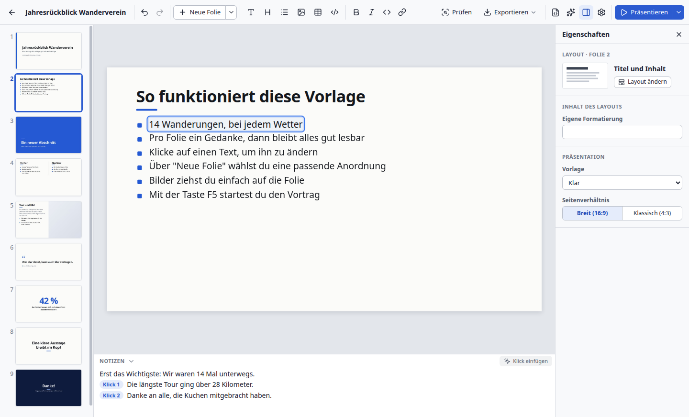
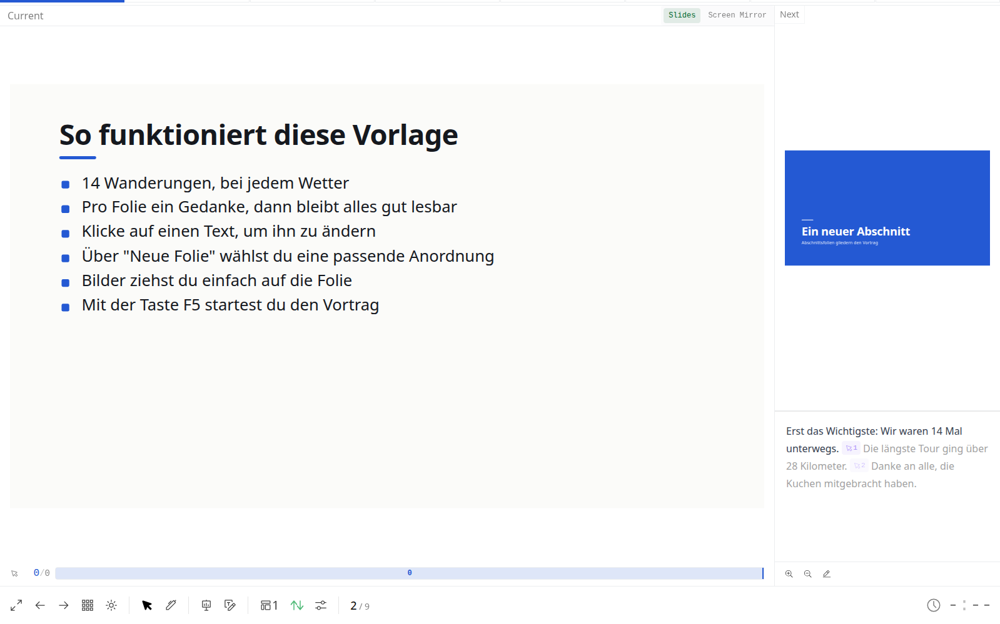
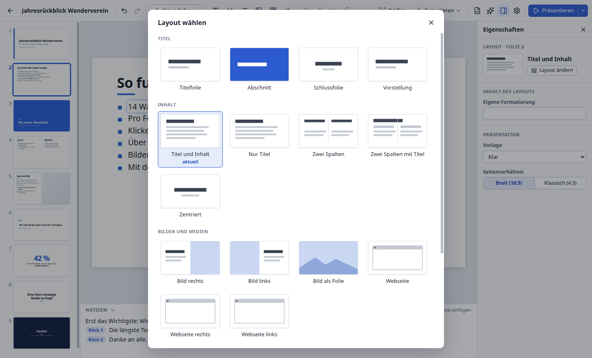

# Podium

Desktop-App für [Slidev](https://sli.dev)-Präsentationen. Du bearbeitest Folien wie in PowerPoint, die Dateien bleiben normales Slidev-Markdown. Deshalb können KI-Agenten und Entwickler am selben Deck arbeiten wie jemand, der nie ein Terminal öffnet.



## Herunterladen

Die aktuelle Version steht unter [Releases](https://github.com/Rasalas/Podium/releases/latest).

| System | Datei | Hinweis zum ersten Start |
| --- | --- | --- |
| macOS (Apple-Chip) | `Podium-…-arm64.dmg` | Öffnen und Podium in "Programme" ziehen. Die App ist signiert und von Apple beglaubigt. |
| macOS (Intel) | `Podium-…-x64.dmg` | wie oben |
| Windows | `Podium-Setup-….exe` | Windows warnt vor einer unbekannten App: "Weitere Informationen", dann "Trotzdem ausführen". |
| Linux | `Podium-….AppImage` oder `podium_…_amd64.deb` | AppImage ausführbar machen und starten. |

Beim ersten Start richtet Podium Slidev ein. Das braucht einmal Internet und dauert etwa eine Minute.

## Updates

Podium sucht im Hintergrund nach neuen Versionen, lädt sie und installiert sie, wenn du die App beendest. Es öffnet sich dafür kein Fenster. Sobald ein Update geladen ist, steht oben "Update bereit". Dort kannst du auch sofort neu starten. Während einer Präsentation wird nichts geladen.

In den Einstellungen lässt sich das abschalten, und es gibt einen Knopf "Nach Updates suchen". Das `.deb`-Paket kann sich nicht selbst ersetzen. Dort zeigt Podium nur an, dass es eine neue Version gibt, und verlinkt den Download.

## Was die App kann

- **Präsentieren mit Beamer.** Ein Knopf legt die Folien im Vollbild auf den zweiten Bildschirm und zeigt auf dem ersten Slidevs Referentenansicht mit Notizen, nächster Folie und Uhr. Das Bearbeitungsfenster blendet sich so lange aus. Esc beendet, im Menü "Präsentieren" lassen sich die Bildschirme tauschen.

  

- **Präsentieren in Zoom oder Teams.** "Im Fenster" zeigt die Folien in einem normalen Fenster mit festem Titel, das du in der Videokonferenz teilst. Die Referentenansicht steht daneben.
- **Handy als Fernbedienung.** Ein QR-Code öffnet Slidevs Referentenansicht auf dem Handy. Über Tailscale erreichen sie nur deine eigenen Geräte, im WLAN jedes Gerät im selben Netz.
- **Bearbeiten auf der Folie.** Text anklicken und tippen. Podium ändert genau die betroffene Zeile in der `slides.md`. Das gilt für jeden sichtbaren Text aus dem Vortrag, auch in HTML, in Tabellen, in der Zeile über dem Titel und in der Fußzeile.
- **Notizen.** Die Höhe lässt sich ziehen, ein Doppelklick auf den Rand zeigt alles. Klick-Marken (`[click]`) fügt ein Knopf oder Strg+Enter ein, sie erscheinen als nummerierte Marken.
- **Vorlagen und Layouts.** Eine Vorlage ist ein Slidev-Theme plus eine Beschreibung seiner Layouts. Daraus entstehen die Layout-Auswahl und die Eigenschaften. Die Vorlage "Klar" ist eingebaut und funktioniert ohne Internet.

  

- **Vorhandene Slidev-Vorträge.** Ein Ordner mit `slides.md` lässt sich direkt öffnen. Liegt die Vorlage im Vortragsordner selbst (als Workspace-Paket, etwa unter `packages/`), nimmt Podium sie von dort.
- **Eigene Vorlagen.** Unter "Neue Präsentation" oder in den Einstellungen fügst du eine Vorlage hinzu: aus der Adresse eines Repositorys bei GitHub oder GitLab (auch die Adresse eines Unterordners), aus einem Zip-Link oder aus einem Ordner. Sie steht danach bei jeder neuen Präsentation zur Auswahl und lässt sich aktualisieren und entfernen. Für private Repositorys muss Git auf dem Rechner angemeldet sein.
- **Pakete ohne Terminal.** Slidev liegt einmal im Benutzerordner, Decks brauchen kein `node_modules`. Nennt ein Deck ein Theme oder Addon, lädt Podium es nach. Pakete von der geprüften Liste installiert es still, bei allen anderen fragt es.
- **Arbeiten mit Agenten.** Jedes neue Deck bekommt eine `AGENTS.md`. Podium zeigt Änderungen von außen sofort an und nimmt sie in den Rückgängig-Verlauf auf. Solange ein Deck offen ist, läuft Slidevs MCP-Server.
- **Prüfen und Exportieren.** Die Prüfung meldet Folien, bei denen Inhalt über den Rand ragt. Export als PDF, PowerPoint mit Folien als Bildern, PNG, Webseite oder als einzelne `.podium`-Datei.

## Entwickeln

```
npm install
npm run dev            App mit Hot Reload
npm run typecheck
npm test               Unit-Tests
npm run build          baut nach out/
npm run test:bridge    Test der Brücke in die Slidev-Seite
npm run test:e2e       Tests in der echten App, braucht xvfb und einen Build
xvfb-run -a node tests/e2e/app/packaged-first-run.mjs    Erststart des gepackten Programms, nach npm run dist
```

Beim ersten Start richtet Podium die Slidev-Laufzeit ein. Das braucht einmal Internet und dauert etwa eine Minute. Mit `PODIUM_RUNTIME_DIR` zeigst du auf eine vorhandene Laufzeit, mit `PODIUM_USER_DATA` auf ein Wegwerf-Profil.

## Installer bauen

```
npm run dist           AppImage und deb unter Linux, dmg unter macOS, nsis unter Windows
                       Die macOS-App ist nur lokal signiert. Auf einem anderen Mac muss man sie beim ersten Start über Rechtsklick, Öffnen freigeben.
npm run seed           legt build/runtime-seed an, danach enthält der Installer Slidev schon
```

Ohne Seed ist der Installer klein und lädt Slidev beim ersten Start. Mit Seed ist er rund 600 MB größer und läuft sofort ohne Internet.

## Version veröffentlichen

```
npm version 0.3.0          setzt die Version und legt den Tag v0.3.0 an
git push --follow-tags
```

Der Tag startet auf GitHub den Ablauf `Release`: Er baut die Installer für macOS, Windows und Linux und hängt sie an ein neues Release. Aus genau diesen Dateien holen sich die installierten Apps ihr Update.

Die macOS-App wird dabei mit einem Developer-ID-Zertifikat signiert und von Apple beglaubigt. Die Zugangsdaten liegen als Geheimnisse im Repository (`MAC_CSC_LINK`, `MAC_CSC_KEY_PASSWORD`, `APPLE_API_KEY_P8`, `APPLE_API_KEY_ID`, `APPLE_API_ISSUER`). Fehlen sie, baut der Ablauf trotzdem, dann ohne Apple-Signatur.

`MAC_CSC_LINK` ist die `.p12`-Datei als Base64. Das macOS der Build-Rechner liest nur das ältere Format mit 3DES und SHA-1. Eine mit OpenSSL 3 erzeugte Datei muss deshalb so umgepackt werden:

```
openssl pkcs12 -in original.p12 -noenc -out tmp.pem
openssl pkcs12 -export -in tmp.pem -keypbe PBE-SHA1-3DES -certpbe PBE-SHA1-3DES -macalg sha1 -out ci.p12
rm tmp.pem
base64 -w0 ci.p12 | gh secret set MAC_CSC_LINK
```

Über "Run workflow" lässt sich der Ablauf auch von Hand starten. Dann baut und prüft er nur und veröffentlicht nichts.

Die Screenshots oben erzeugt `xvfb-run -a -s "-screen 0 1600x1000x24" node scripts/screenshots.mjs`.

## Aufbau

Die Architektur, die Regeln für Beiträge und die Eigenheiten von Slidev 53 stehen in [AGENTS.md](AGENTS.md). Das Format für Vorlagen steht in [templates/README.md](templates/README.md).

## Lizenz

[MIT](LICENSE)
